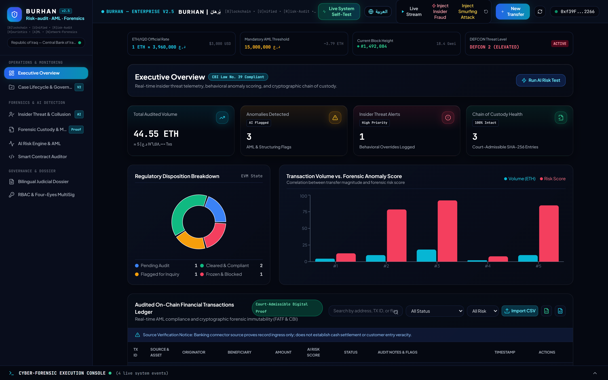
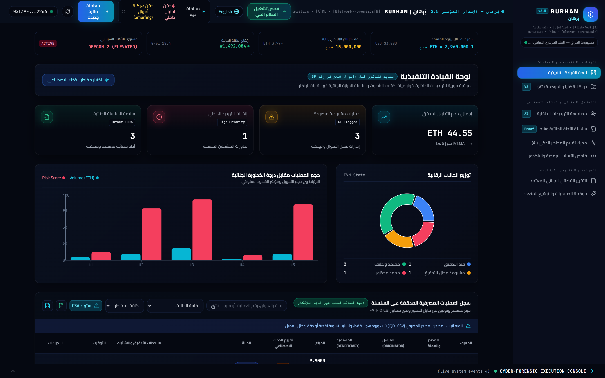

<div align="center">



<br/>

# BURHAN | بُرهان

### Blockchain Unified Risk-audit, Heuristic AML & Network-forensics

**المنظومة الموحدة لتقييم مخاطر سلاسل الكتل، والتدقيق الاستدلالي، والتحريات الجنائية لمكافحة غسل الأموال**

<sub>Integrating Digital Forensics and Financial Accounting — A Cyber-Auditing System for Mitigating Insider Threat Fraud</sub>

<br/>

```
========================================================================================
 [B]lockchain  •  [U]nified  •  [R]isk-Audit  •  [H]euristics  •  [A]ML  •  [N]etwork-Forensics
========================================================================================
```

| Letter | Pillar | What it delivers |
|:---:|:---|:---|
| **B** | **Blockchain** | Immutable on-chain audit ledger — Solidity 0.8.20, hash-linked chain of custody |
| **U** | **Unified** | One unified governance plane: identity, cases, evidence, and compliance policy |
| **R** | **Risk-audit** | Deterministic AML/KYC rule enforcement + smart contract risk auditing |
| **H** | **Heuristics** | ML anomaly scoring (Isolation Forest) + financial forensic heuristics |
| **A** | **AML** | CBI Law No. 39 / FATF compliance, structuring & smurfing detection |
| **N** | **Network-forensics** | Wallet network tracing, insider-collusion graph, digital chain of custody |

<br/>

[](https://soliditylang.org/)
[](https://hardhat.org/)
[](https://fastapi.tiangolo.com/)
[](https://python.org)
[](https://react.dev/)
[](https://tailwindcss.com/)

[](./test)
[](./audit-report/SECURITY_AUDIT.md)
[](./audit-report/SECURITY_AUDIT.md)
[](./docs/architecture.md)
[](./LICENSE)

[Architecture](./docs/architecture.md) • [Defense Presentation](./docs/defense-presentation.md) • [Security Audit](./audit-report/SECURITY_AUDIT.md) • [API Reference](./docs/api-reference.md) • [Threat Model](./docs/threat-model.md)

</div>

---

## 📖 Overview | نظرة عامة

**BURHAN (بُرهان)** is an enterprise-grade hybrid cyber-auditing and digital-forensic platform that bridges **Financial Forensic Accounting**, **Digital Forensics**, and **Machine Intelligence** into a single auditable system.

> **بُرهان** — المنظومة الموحدة التي تدمج المحاسبة المالية الجنائية، والتحقيق الجنائي الرقمي، والذكاء الاصطناعي، في مسار تدقيق واحد قابل للإثبات أمام القضاء.

Traditional financial auditing relies on retrospective periodic sampling, manual spreadsheet reviews, and centralized ERP databases — leaving institutions acutely vulnerable to **authorized insider threats** (auditors, compliance managers, privileged operators) who exploit administrative access to override AML controls, manipulate system logs, or collude in illicit transfers.

BURHAN resolves the insider-threat dilemma by enforcing **cryptographic Zero-Trust governance** across three integrated tiers:

1. **On-Chain Cryptographic Consensus** (Solidity `^0.8.20`) — deterministic AML/KYC rule enforcement, multi-signature 4-eyes controls, separation of duties, and an append-only tamper-evident forensic chain of custody.
2. **Off-Chain AI Reasoning Engine** (FastAPI + ML) — pre-execution fraud scoring (Isolation Forest + heuristics), structuring/smurfing detection, operator behavioral profiling, and AST-based smart contract backdoor auditing.
3. **Forensic Telemetry Console** (React 18 + Vite + Tailwind) — bilingual (Arabic RTL / English LTR) judicial console with 7 investigative modules and verifiable forensic dossiers.

---

## 🖼️ Interface Preview | واجهة النظام

<div align="center">

**Executive Overview — English (LTR)**


**لوحة القيادة التنفيذية — العربية (RTL)**


</div>

---

## 🏛️ Tri-Tier Architecture | المعمارية ثلاثية الطبقات

```
+-----------------------------------------------------------------------------------+
|                    TIER 3: PRESENTATION & FORENSIC TELEMETRY                      |
|     React 18 + Vite + Tailwind CSS 3.4 | Dark Glassmorphic Cyber Interface        |
|     Bilingual (Arabic RTL / English LTR) | 7 Specialized Forensic Modules        |
+-----------------------------------------------------------------------------------+
                                    |               |
                         JSON-RPC   |               | REST / OpenAPI v2 + v3
                         WebSockets |               | (Port 8000)
                                    v               v
+-----------------------------------------------------------------------------------+
|                       TIER 2: OFF-CHAIN AI REASONING ENGINE                       |
|  - FastAPI Microservice                      - Isolation Forest Anomaly Detection |
|  - Pre-Execution Anomaly Scoring             - Insider Threat Behavioral Profiler |
|  - Structuring / Smurfing Pattern Engine     - Smart Contract Backdoor Auditor    |
|  - Bilingual Judicial Dossier Generator      - Continuous Blockchain Event Sync   |
+-----------------------------------------------------------------------------------+
                                    |
                           Smart Contract Calls & Event Emission
                                    v
+-----------------------------------------------------------------------------------+
|                  TIER 1: ON-CHAIN IMMUTABLE CRYPTOGRAPHIC CONSENSUS               |
|  RoleManager.sol       MultiSigApproval.sol       AuditEngine.sol                 |
|  - Hierarchical RBAC   - Four-Eyes Principle      - Separation of Duties (SoD)    |
|  - Timelocked Policies - Dual Authorization       - Emergency Circuit Breaker     |
|                                                                                   |
|  ForensicTrail.sol                                InsiderActivityLog.sol          |
|  - Recursive SHA-256 Chain of Custody             - Operator Behavioral Counters  |
|  - Merkle-Anchored Evidence Records               - Collusion & Override Alarms   |
+-----------------------------------------------------------------------------------+
```

---

## ✨ Key Capabilities | القدرات الأساسية

### 1. On-Chain Smart Contract Core (`contracts/`)

| Capability | Implementation | Forensic value |
|:---|:---|:---|
| Deterministic AML/KYC rules | `AuditEngine.sol` + `ComplianceRules.sol` | Non-bypassable regulatory thresholds |
| Chain of custody | `ForensicTrail.sol` | `EntryHashₙ = keccak256(n, ts, type, operator, actor, evidenceHash, EntryHashₙ₋₁)` |
| Insider telemetry | `InsiderActivityLog.sol` | After-hours ops, override sprees, beneficiary concentration |
| Separation of Duties | Governance coordinator | Actors cannot vote/clear their own transactions |
| Four-Eyes control | `MultiSigApproval.sol` | $M$-of-$N$ quorum ($M \ge 2$) for every high-risk action |
| Timelocked governance | 24h / 86,400s timelock | Prevents hasty unauthorized policy mutation |

### 2. Off-Chain AI Reasoning Engine (`ai-engine/`)

- **Multi-Factor Fraud Detection** — ML (Isolation Forest) fused with forensic-accounting heuristics.
  - *Structuring / Smurfing*: slices inside $[0.85 \times \text{Limit},\ \text{Limit})$.
  - *Velocity spikes*: 24h volume bursts and frequency anomalies.
  - *KYC state*: sender and counterparty verification.
- **Insider Threat Behavioral Profiler** — risk coefficients per operator: anomalous access patterns, sub-10-second approvals, override sprees.
- **Solidity Backdoor Auditor** — AST + heuristic scan for insider-planted backdoors (`tx.origin` CWE-287, arbitrary `selfdestruct` CWE-284, reentrancy CWE-829, unbounded minting).
- **Bilingual Forensic Dossier Generator** — court-admissible reports (AR/EN) with Merkle proofs and timestamps.

### 3. Forensic Telemetry Console (`frontend/`)

1. `Dashboard` — transaction flow, AML disposition, high-velocity alerts, KPI telemetry.
2. `Case Workspace` — incident lifecycle and evidence-chain tracking.
3. `Insider Threat Monitor` — operator threat matrix, override counters, collusion detection.
4. `Forensic Explorer` — visual chain of custody with live hash verification and tamper simulation.
5. `AI Risk Scoring Panel` — pre-execution scoring simulator and structuring alerts.
6. `Smart Contract Auditor` — backdoor scanner with sample vulnerable contracts.
7. `Governance & MultiSig` — dual-control proposals, 4-eyes voting queue, RBAC directory.

---

## ⚖️ Regulatory Compliance Matrix | مصفوفة الامتثال

Aligned with **Central Bank of Iraq AML/CFT Law No. 39 of 2015** and the **FATF 40 Recommendations**.

| Parameter | Reference | Threshold | System action | Enforcement |
|:---|:---|:---|:---|:---|
| **Large Transaction (CTR)** | AML Law No. 39 (Art. 12) / FATF Rec. 10 | > 10,000 ETH equiv. | Flag for mandatory review | Auto-record in `ForensicTrail` |
| **KYC Mandate** | CBI KYC Regulations | > 5,000 ETH equiv. | Block if unverified | Enforce verified identity |
| **Daily Velocity Cap** | Structuring & velocity monitoring | > 50,000 ETH/day | Flag + freeze outflow | MultiSig audit override |
| **Structuring (Smurfing)** | FATF Rec. 20 (STRs) | 85%–99.9% of threshold | Flag as structuring | AI score +35 pts |
| **Max Single Transfer** | Absolute hard stop | 100,000 ETH equiv. | Immediate hard revert | Cryptographically non-bypassable |
| **Warning Override** | Four-Eyes principle | Any override request | Require MultiSig approval | $M$-of-$N$ quorum ($M \ge 2$) |

---

## 📂 Repository Structure | هيكل المستودع

```text
burhan/
├── contracts/                          # Solidity 0.8.20 smart contracts
│   ├── AuditEngine.sol                 # Core AML compliance & audit engine
│   ├── ComplianceRules.sol             # Regulatory thresholds
│   ├── access/
│   │   ├── RoleManager.sol             # Hierarchical RBAC
│   │   └── MultiSigApproval.sol        # Four-eyes dual control
│   ├── forensics/
│   │   ├── ForensicTrail.sol           # Hash-linked chain of custody
│   │   └── InsiderActivityLog.sol      # Behavioral operator telemetry
│   ├── libraries/EvidenceHashing.sol   # Canonical V2 evidence hashing
│   └── interfaces/                     # Contract interfaces
├── ai-engine/                          # Python 3.11+ AI reasoning service
│   ├── app/
│   │   ├── main.py                     # FastAPI entry point
│   │   ├── models/                     # Fraud detector, insider analyzer
│   │   ├── routes/                     # REST v2 / v3 / forensics
│   │   └── services/                   # Evidence, chain, signing, backup
│   └── tests/                          # 221 API / ML / integration tests
├── frontend/                           # React 18 + Vite + Tailwind console
│   ├── src/components/                 # 7 forensic & audit modules
│   ├── src/config/                     # Strict runtime schema
│   └── src/utils/i18n.js               # Arabic / English translations
├── deployments/                        # Verified deployment manifests
├── scripts/                            # Deploy, verify, simulate, screenshot
├── docs/                               # Architecture, threat model, runbooks
│   └── assets/                         # Interface screenshots
├── audit-report/SECURITY_AUDIT.md      # Formal vulnerability audit
├── hardhat.config.js
└── package.json
```

---

## 🚀 Quick Start | التشغيل السريع

**Prerequisites:** Node.js ≥ 18, npm ≥ 9, Python ≥ 3.11, Git

```bash
# 1. Clone
git clone https://github.com/H0777/burhan.git
cd burhan

# 2. Install
npm install
npm --prefix frontend install
pip install -r ai-engine/requirements.txt

# 3. Compile & test contracts
npx hardhat compile
npx hardhat test

# 4. Start local chain (terminal 1)
npx hardhat node

# 5. Deploy contracts (terminal 2)
npm run deploy:local

# 6. Run the AI engine (terminal 3)
cd ai-engine && uvicorn app.main:app --host 0.0.0.0 --port 8000

# 7. Run the console (terminal 4)
npm --prefix frontend run dev    # http://localhost:5173
```

---

## 🧪 Verification Gates | بوابات التحقق

```bash
npm run verify:all      # contracts + api + frontend + integration
```

| Subsystem | Framework | Tests | Status |
|:---|:---|---:|:---:|
| Smart Contracts | Hardhat / Mocha / Chai | **206** | ✅ 100% |
| AI Engine & API | PyTest / FastAPI TestClient | **221** | ✅ 100% |
| Frontend Console | Vitest / React Testing Library | **65** | ✅ 100% |
| Trust-flow E2E | Playwright | **8** | ✅ 100% |
| **Total** | Multi-layer integration | **500** | ✅ **100%** |

---

## 🔒 Security Remediation Register | سجل المعالجة الأمنية

| ID | Finding | Remediation | Status |
|:---:|:---|:---|:---:|
| F01 | Test mutator backdoor in production ABI | Backdoor removed from ABI/bytecode (R01) | ✅ |
| F02 | Wallet recycling / duplicate enrollment | Immutable identity binding + rotation (R02) | ✅ |
| F03 | Self-adjudication of own transactions | Separation of Duties enforced (R03) | ✅ |
| F04 | Contract size over EIP-170 | 24,000 B runtime budget gate (R04) | ✅ |
| F05 | Unverifiable dossier manifests | Standalone offline verifier CLI (R09) | ✅ |
| F06 | Outbox delivery without crash recovery | Leased outbox + nonce discipline (R08) | ✅ |
| F07 | Case transitions without CAS | SQL compare-and-swap + idempotency (R12) | ✅ |
| F09 | Silent runtime-config fallback | Strict schema, fail-closed mount (R13) | ✅ |
| F11 | Replayable stale unpause proposals | Epoch-protected emergency pause (R14) | ✅ |
| F12 | Backups without tamper evidence | Encrypted backups + integrity chain (R16) | ✅ |
| F14 | Missing end-to-end trust-flow proof | 8/8 Playwright E2E acceptance (R19–R21) | ✅ |

Full register: [`docs/verification/remediation/findings.csv`](./docs/verification/remediation/findings.csv) · Formal audit: [`audit-report/SECURITY_AUDIT.md`](./audit-report/SECURITY_AUDIT.md)

---

## 🗺️ Documentation | التوثيق

| Document | Description |
|:---|:---|
| [Architecture](./docs/architecture.md) | Tri-tier system design and data flows |
| [Threat Model](./docs/threat-model.md) | Adversary model and trust boundaries |
| [Trust Boundary & Identity](./docs/trust-boundary-identity.md) | OIDC identity, wallet binding |
| [API Reference](./docs/api-reference.md) | OpenAPI v2/v3 surface |
| [Key Management Runbook](./docs/runbooks/key-management.md) | Ed25519 custody and rotation |
| [Defense Presentation](./docs/defense-presentation.md) | Academic defense deck |
| [Security Audit](./audit-report/SECURITY_AUDIT.md) | Findings and remediation evidence |
| [Remediation Evidence](./docs/verification/remediation) | Per-lane verified evidence (R01–R21) |

---

## 👨‍💻 Author & Academic Attribution

**Hussein Faez** — *Digital Forensics, Cybersecurity & Financial Accounting* — Republic of Iraq 🇮🇶
GitHub: [@H0777](https://github.com/H0777)

> **Academic Thesis / Research Project**
> *"Integrating Digital Forensics and Financial Accounting: A Cyber-Auditing System for Mitigating Insider Threat Fraud"*
> Combining distributed ledger technology, machine learning, and forensic accounting to protect sovereign and commercial banking infrastructure against authorized insider threats.

---

## 📄 License

MIT — see [LICENSE](./LICENSE).

<div align="center">

**BURHAN | بُرهان** — Built for the security of the Iraqi Banking Sector 🇮🇶

</div>
