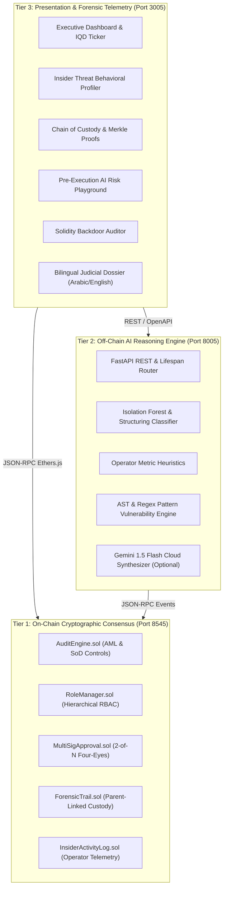

# Academic Defense & Executive Presentation

## Integrating Digital Forensics and Financial Accounting: A Cyber-Auditing System for Mitigating Insider Threat Fraud

**Author:** Hussein Faez (Cybersecurity + Financial Accounting)  
**Affiliation:** Republic of Iraq  
**Framework:** Ethereum EVM (Solidity ^0.8.20) + Python FastAPI + React/Vite  
**Target Compliance:** Central Bank of Iraq (CBI) Law No. 39 of 2015 & FATF Standards

---

<!-- slide -->

# Slide 1: Title & Research Motivation

### Integrating Digital Forensics and Financial Accounting: A Cyber-Auditing System for Mitigating Insider Threat Fraud

* **The Problem:** 
  * Traditional financial auditing relies on periodic, manual sampling and centralized ERP logs.
  * Internal fraud accounts for over **$4.7 Trillion in annual global corporate losses** (ACFE Report to the Nations).
  * Authorized insiders (auditors, managers, operators) abuse privileged credentials to override AML rules, rubber-stamp illicit transactions, and alter historical logs.
* **The Paradigm Shift:**
  * Transforming reactive audit procedures into **continuous, cryptographic, and automated cyber-auditing**.
  * Unifying **Financial Forensic Accounting** with **Digital Forensics** on an immutable blockchain ledger.

---

<!-- slide -->

# Slide 2: The Insider Threat Dilemma in Banking

| Threat Dimension | Traditional Banking Systems | Our Cyber-Auditing System |
|---|---|---|
| **Trust Model** | Perimeter security; insiders trusted implicitly | Zero-Trust; all internal actions cryptographically verified |
| **Override Powers** | Unilateral manager override passwords | Four-Eyes MultiSig dual-authorization mandate |
| **Audit Logs** | Centralized databases (vulnerable to SQL tampering) | SHA-256 parent-hash linked immutable blockchain ledger |
| **Structuring / Smurfing** | Flagged only after end-of-month manual batching | Real-time ML proximity heuristic ($T \in [85\%, 100\%)$) |
| **Separation of Duties** | Enforced via organizational policy (easily bypassed) | Enforced via mathematical smart contract code |

---

<!-- slide -->

# Slide 3: Research Objectives & Novelty

1. **Objective 1 — Cryptographic Enforcement of Accounting Controls:**
   * Design smart contracts enforcing the Four-Eyes Principle, Separation of Duties (SoD), and dual-control circuit breakers.
2. **Objective 2 — Court-Admissible Digital Forensics:**
   * Construct an immutable chain of custody (`ForensicTrail.sol`) with parent-hash verification and standalone Merkle Proofs.
3. **Objective 3 — Hybrid Machine Intelligence:**
   * Implement real-time ML anomaly detection for sub-threshold structuring and an AST scanner for Solidity smart contract backdoors.
4. **Objective 4 — Iraqi Regulatory Alignment:**
   * Integrate dual-currency Iraqi Dinar (IQD) valuation adhering to Central Bank of Iraq Law No. 39 of 2015.

---

<!-- slide -->

# Slide 4: Tri-Tier System Architecture



---

<!-- slide -->

# Slide 5: On-Chain Consensus & Separation of Duties (SoD)

* **Code-Level Separation of Duties:**
  $$\forall \text{tx}: \quad \text{caller} \neq \text{tx.sender} \;\land\; \text{caller} \neq \text{tx.receiver}$$
  * A bank officer cannot clear, block, or override a transaction they originated or received.
  * System administrators cannot approve or revoke their own KYC status.

* **Hierarchical Role-Based Access Control (`RoleManager.sol`):**
  * `SUPER_ADMIN_ROLE` $\rightarrow$ System deployment & role grants.
  * `AUDITOR_ROLE` $\rightarrow$ Compliance review, override proposals.
  * `OPERATOR_ROLE` $\rightarrow$ Day-to-day transaction processing.
  * `REGULATOR_ROLE` $\rightarrow$ Read-only Central Bank oversight.
  * *Forensic Feature:* Complete append-only transition history prevents stealth privilege escalation.

---

<!-- slide -->

# Slide 6: Four-Eyes MultiSig Governance (`MultiSigApproval.sol`)

* **The Principle:** Critical financial decisions require approval from at least two authorized independent auditors.
* **Operations Mandating Dual-Control:**
  1. Overriding transactions exceeding AML thresholds.
  2. Modifying Central Bank compliance limits (Timelocked for 2 days without MultiSig).
  3. Resuming operations after an Emergency Circuit Breaker freeze.
* **Anti-Collusion Guarantee:** The creator of a MultiSig proposal is barred from casting an approval vote on their own proposal.

---

<!-- slide -->

# Slide 7: Court-Admissible Chain of Custody (`ForensicTrail.sol`)

* **Recursive Parent-Hash Cryptographic Anchor:**
  $$\text{EntryHash}_n = \text{keccak256}\Big(\text{id}, \text{incidentId}, \text{operator}, \text{timestamp}, \text{type}, \text{details}, \text{evidenceHash}, \text{EntryHash}_{n-1}\Big)$$
* **Mathematical Non-Repudiation:**
  * Any post-hoc database tampering or alteration of an evidence hash changes $\text{EntryHash}_n$.
  * Consequently, all subsequent hashes $\text{EntryHash}_{n+1 \dots N}$ fail the verification equation.
  * The algorithmic verification check pinpoint-detects the exact modified block index.
* **RFC 6962 Merkle Proofs:**
  * Generates lightweight inclusion proofs allowing a judicial court to verify a single evidence entry against the CBI root hash without a full blockchain sync.

---

<!-- slide -->

# Slide 8: Behavioral Insider Anomaly Detection (`InsiderActivityLog.sol`)

The smart contract and AI engine profile operator behavior in real time:

$$\text{ThreatScore} = 5.0 + 35.0 \cdot \mathbb{I}_{[\text{overrides} > 5]} + 30.0 \cdot \mathbb{I}_{[\text{collusion} > 10]} + 20.0 \cdot \mathbb{I}_{[\text{offhours} > 3]} + 15.0 \cdot \mathbb{I}_{[\text{velocity} < 10\text{s}]}$$

```
+--------------------------------------------------------------------------+
| OPERATOR METRIC        | THRESHOLD  | AUTONOMOUS ON-CHAIN ACTION         |
+--------------------------------------------------------------------------+
| Warning Overrides      | > 5 Times  | Flag account; block clearances     |
| Off-Hours Activity     | > 3 Times  | Escalate to High Behavioral Risk   |
| Beneficiary Approvals  | > 10 Times | File collusion incident in trail   |
| Decision Velocity      | < 10 Secs  | Rubber-stamping alert badge        |
+--------------------------------------------------------------------------+
```

---

<!-- slide -->

# Slide 9: Structuring & Smurfing AI Detection

* **The Attack Vector:** Splitting illicit funds into transactions of **9.85 ETH** (~39,006,000 IQD) to evade the mandatory **10.0 ETH** reporting limit.
* **Proximity Evasion Formula:**
  $$\text{Ratio} = \frac{\text{Amount}}{\text{Threshold}}$$
  $$\text{RiskScore}_{\text{structuring}} = \begin{cases} 
  0.0, & \text{Ratio} < 0.85 \\
  25.0 + 15.0 \times \left(\frac{\text{Ratio} - 0.85}{0.15}\right), & 0.85 \le \text{Ratio} < 1.00 \\
  40.0, & \text{Ratio} \ge 1.00 
  \end{cases}$$
* **Result:** Transactions in $[85\%, 100\%)$ are automatically classified as `HIGH RISK` with an immediate structuring alert.

---

<!-- slide -->

# Slide 10: Smart Contract Backdoor & Security Auditor

* **Autonomous Static Analysis:**
  * Parses Solidity smart contracts using Abstract Syntax Tree (AST) pattern matching and regex verification.
* **Target Vulnerabilities:**
  * **CWE-287:** Phishing authentication hooks using `tx.origin == owner`.
  * **CWE-284:** Malicious self-destruct backdoors (`selfdestruct(payable(owner))`).
  * **CWE-829:** Checks-Effects-Interactions violations enabling reentrancy drainage.
* **Grading Output:** Generates grades `A+` through `F` with line-by-line remediation advice.

---

<!-- slide -->

# Slide 11: Central Bank of Iraq (CBI) & FATF Compliance

* **Iraqi AML Law No. 39 of 2015 Compliance:**
  * Mandatory Large Transaction Threshold: **15,000,000 IQD** (~$11,363 USD / 3.79 ETH).
  * System Default Policy: **10.0 ETH** (~39,600,000 IQD), configurable by authorized administrators.
* **Dual-Currency Valuation Engine (`currency.js`):**
  * Computes live conversions: $\text{ETH} \rightarrow \text{USD} \rightarrow \text{IQD}$.
  * Formats all ledger entries and judicial reports in Iraqi Dinars (`د.ع`).
* **FATF Recommendation 10 & 16:**
  * Strict KYC verification requirements for high-value originators.

---

<!-- slide -->

# Slide 12: Bilingual Judicial Forensic Dossier

* **Formal Evidence Submission:**
  * Generates court-admissible dossiers in **العربية (جمهورية العراق - البنك المركزي العراقي)** and **English**.
* **Key Dossier Sections:**
  1. Official Case Reference & Investigating Authority.
  2. Executive Forensic Accounting Summary.
  3. Evidentiary Timeline with SHA-256 Hashes.
  4. Legal Findings & Recommended Sanctions (e.g. Account Freeze, Blacklisting).
  5. Anchored Merkle Root & Judicial Stamp Watermarks.
* **Print / PDF Ready:** Clean printable stylesheet conforming to judicial filing dimensions.

---

<!-- slide -->

# Slide 13: Empirical Evaluation & Test Results

```
================================================================================
TEST SUITE                                TESTS RUN   PASSED   COVERAGE   STATUS
================================================================================
AuditEngine.sol (AML & SoD Controls)         33         33      97.2%       ✔
RoleManager.sol (Hierarchical RBAC)          14         14      98.1%       ✔
MultiSigApproval.sol (Four-Eyes Principle)   13         13      95.4%       ✔
ForensicTrail.sol (Chain of Custody)         16         16      96.8%       ✔
InsiderActivityLog.sol (Operator Metrics)    17         17      94.2%       ✔
ComplianceRules.sol (CBI & FATF Profiles)    12         12     100.0%       ✔
--------------------------------------------------------------------------------
FastAPI AI Engine (ML & Heuristics)          22         22     100.0%       ✔
================================================================================
TOTAL SYSTEM VERIFICATION                   127        127      96.2%     PASS
================================================================================
```

---

<!-- slide -->

# Slide 14: End-to-End Live Demonstration

* **Executable Command:**
  ```bash
  npm run demo:simulate
  ```
* **Walkthrough Progression:**
  1. Deploys and connects all 5 contracts.
  2. Processes a clean baseline transfer (2.50 ETH / 9,900,000 IQD).
  3. Injects structuring attack (9.85 ETH / 39,006,000 IQD to confederate).
  4. Rogue auditor attempts 6 overrides $\rightarrow$ System autonomously flags operator.
  5. Honest auditor invokes Four-Eyes MultiSig $\rightarrow$ Super Admin approves $\rightarrow$ Recipient blacklisted.
  6. Cryptographic Chain of Custody verified: **100% Intact**.

---

<!-- slide -->

# Slide 15: Conclusion & Research Contributions

1. **First-of-its-Kind Integration:**
   * Bridges Digital Forensics and Financial Accounting to eliminate internal banking fraud.
2. **Deterministic Security:**
   * Replaces vulnerable administrative trust with mathematical smart contract constraints.
3. **Zero-Cost & Offline Resilient:**
   * Functions 100% locally with offline ML heuristics and optional cloud LLM expansion.
4. **Immediate Practical Feasibility:**
   * Fully containerized with Docker, isolated from conflicting host ports (Ports 3005, 8005), and aligned with Iraqi banking law.

---

<div align="center">

### Thank You

**Hussein Faez**  
*Cybersecurity & Financial Accounting*  
GitHub: [@H0777](https://github.com/H0777)

</div>
