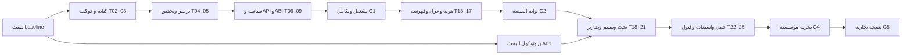

# Three-Track Development Implementation Plan — الخطة الرئيسية

> **For agentic workers:** REQUIRED SUB-SKILL: Use superpowers:subagent-driven-development (recommended) or superpowers:executing-plans to implement this plan task-by-task. Steps use checkbox (`- [ ]`) syntax for tracking.

**Goal:** تطوير أساس واحد يحقق بحثاً قابلاً للتكرار، وتجربة مؤسسية موثوقة، ونسخة تجارية تجريبية متعددة المؤسسات.

**Architecture:** React/FastAPI بوحدات واضحة، PostgreSQL مع عزل مؤسسات، مخزن أدلة مشفر، عامل فهرسة، وعقود EVM للحوكمة والإثباتات. الإصدار القديم يبقى للقراءة/المحاكاة؛ عقود V2 ونماذج API V2 تحمل الضوابط الجديدة.

**Tech Stack:** التقنيات الحالية Solidity 0.8.20، Hardhat 2، React 18، Vite 5، Python 3.11/FastAPI؛ إضافة PostgreSQL وOIDC وتخزين كائنات واختبارات تكامل عند الحاجة.

**Spec:** [التصميم والمتطلبات R01–R18](../specs/2026-10-22-three-track-development-design.md).

## Global Constraints

- الحفاظ على React 18 وVite 5 وFastAPI وSolidity 0.8.20/Hardhat 2 في مرحلة التثبيت؛ الترقيات الكبيرة لها مهمة مستقلة لاحقاً.
- إدخال `institution_id` وعزل المؤسسات منذ أول تخزين دائم، واختباره بمؤسستين اصطناعيتين، حتى لو بدأت التجربة المؤسسية بجهة واحدة.
- وضع مؤسسي لا ينشئ نجاحاً أو صلاحيات أو أدلة من محاكاة صامتة؛ معرفات الإصدارات والبيانات ظاهرة.
- المحافظة على تعديلات المستخدم؛ لا git add شامل أو reset أو حذف/إعادة نشر عقود خارجية.
- الخطة والاختبارات المذكورة تصف عملاً مستقبلياً؛ لا تعتبر مربعات الاختيار المكتوبة اختبارات منفذة.

## Review Focus

1. تعطل RPC أثناء تصدير التقرير: تبقى النتيجة unavailable، ولا يتحول التقرير إلى موثق؛ T05/T20.
2. مصوت سُحب دوره أو تغير محتوى الاقتراح: التنفيذ يُرفض؛ T03.
3. معرف قضية صحيح من مؤسسة أخرى: تُرفض قراءته وتصديره وتخزين دليل عليه؛ T14/T16/C01.
4. مبلغ كبير/وحدة خاطئة/منتصف الليل في بغداد: لا فقد دقة ولا نافذة زمنية مضللة؛ T06/T18.
5. انقطاع بعد إدراج حدث أو وصول log أُلغي بإعادة تنظيم: يستأنف دون تكرار أو بقاء قرار مؤكد كاذب؛ T15.

## 1. مسارات العمل والنتائج

| المسار | يبدأ | التسليم الأول | يعتمد على |
|---|---|---|---|
| A أكاديمي | الأسبوع 1: بروتوكول التجارب ونموذج التهديد | الأسبوع 12: مسودة دراسة + حزمة إعادة النتائج | صحة التسجيل والتقييم، فصل البيانات، نتائج مقاسة |
| I مؤسسي | الأسبوع 1: دورة عمل مرجعية | الأسبوع 16: حزمة تجربة محدودة | G1 سلامة الأساس، G2 منصة مؤسسية، G3 قياس وتشغيل |
| C تجاري | الأسبوع 1: مخطط عزل المؤسسات | الأسابيع 24–28: نسخة تجارية تجريبية | نجاح تجربة I، عزل، حصص، دعم، ومراجعة إطلاق |

الأهداف متوافقة لأن البحث يقيس المحرك نفسه، والتجربة تختبر استخدامه، والتجارة تضيف التشغيل المتكرر لعدة مؤسسات. الجاهزية الأكاديمية لا تمنح جاهزية مالية تلقائياً، ونجاح العرض لا يثبت جدوى السوق.

## 2. الجدول التقديري

تقدير تخطيطي لفريق متفرغ يغطي أربعة أدوار هندسية: Web3/حوكمة، Backend/Data، Frontend، QA/DevOps، مع قائد تقني من الفريق ومالك منتج/امتثال جزئي. الباحث قد يكون مهندس البيانات نفسه مع تخصيص وقت معلن. الأشخاص غير محددين حالياً. التنفيذ الفردي يعاد تقديره بعد أول سباق؛ الأسابيع تبدأ عند بدء التنفيذ، وليست مواعيد تقويمية ملزمة.

| الفترة | الحزمة | المخرجات | البوابة |
|---|---|---|---|
| أسبوع 1–2 | T01–T05 | baseline واختبارات الثغرات، هوية كتابة، حوكمة وإثباتات | مراجعة أمنية مرحلية |
| أسبوع 3–5 | T06–T12 | سياسة موحدة، تكامل فعلي، نشر محلي قابل للتكرار، CI | G1: أساس موثوق |
| أسبوع 6–9 | T13–T17 | هوية مؤسسية، تخزين معزول، فهرسة، دورة قضية | G2: منصة تجريبية |
| أسبوع 10–12 | T18–T21 + A01 | تقييم موثق، بحث مقارن، تقارير، فحص صادق | G3: جاهزية بحثية |
| أسبوع 13–16 | T22–T25 | حمل واستعادة ومراجعة مستقلة وقبول المستخدم | G4: جاهزية تجربة I |
| أسبوع 17–24 | C01–C06 + تشغيل تجربة I | دورة عميل وحصص ودعم؛ تجربة مصرح بها 30 يوماً ومعالجة ملاحظاتها | G4b: قبول نتائج التجربة ثم G5 |
| أسبوع 25–28 | احتياطي مخاطر | معالجة نتائج تجربة/مراجعة، تثبيت وتوثيق | لا مزايا جديدة غير ضرورية |

النطاق واسع؛ لا تختصر اختبارات العزل أو الأدلة أو الحوكمة لحماية الجدول. إذا تأخرت البيانات المعتمدة يمكن تسليم البحث الاصطناعي معلناً حدوده، وتبقى التجربة الحقيقية مؤجلة.

## 3. حزم التنفيذ التفصيلية

1. [الأساس والثقة والتكامل — T01–T12](2026-10-22-phase-1-trust-and-integration.md).
2. [المنصة المؤسسية والبيانات — T13–T17](2026-10-22-phase-2-institutional-platform.md).
3. [البحث والذكاء والتجربة — T18–T25 وA01](2026-10-22-phase-3-research-and-pilot.md).
4. [التجهيز التجاري — C01–C06](2026-10-22-phase-4-commercial-readiness.md).

## 4. المسؤوليات وحدود الكتابة

| الدور | المسؤولية | الملفات الأساسية |
|---|---|---|
| القائد التقني | اتفاق الواجهات، دمج، مراجعة المخاطر والانتقال | docs، ملفات التكامل المشتركة |
| Web3 | العقود والحوكمة والترميز والاختبارات والنشر | contracts، test، scripts/deploy.js |
| Backend/Data | API والهوية والسياسات والبيانات والفهرسة والبحث | ai-engine/app، migrations، tests، research |
| Frontend | عرض البيانات والحالات والموافقات وتجربة عربية/إنجليزية | frontend/src |
| QA/DevOps | بيئة التكامل وCI والحمل والاستعادة | tests/e2e، .github، docker، ops |
| مالك المنتج/الامتثال | دورة التحقيق ومصادر القواعد وقبول التجربة | requirements، UAT، سجل السياسات |
| المراجع المستقل | مراجعة نهائية للأمان والأدلة والعزل | قراءة الكود وتقارير؛ لا يوافق على عمله بنفسه |

مالك واحد وقتياً لكل package.json/lockfile/requirements/Compose/OpenAPI/generated files. تعديل عقد الواجهة يسبق عمل المستهلكين. تشغيل builds وتثبيت الاعتماديات المشتركة متسلسل. أي تفويض تنفيذي يحدد ملفات مسموحة ومعيار قبول؛ لا استخدام تلقائي لوكلاء في هذه المرحلة التخطيطية إلا لمراجعة الوثيقة.

## 5. الاعتماديات والمسار الحرج

التداخل الممكن: بروتوكول البحث والتوثيق وإصلاح lint مع العمل الأمني؛ الواجهة تبدأ بعد تجميد مخططات T06/T07. لا يوازي مالكان تعديل الملف نفسه، ولا يبدأ استهلاك مخطط لم يُقر بعد.

## 6. أول عشرة أيام عمل

| اليوم | الناتج المتوقع | التحقق |
|---|---|---|
| 1 | سجل baseline ومخاطر وتجارب إعادة المشكلة، وحماية التعديلات القائمة | جرد Git وتسجيل أوامر الاختبارات ونتائجها |
| 2 | اختبارات رفض انتحال النشاط وتعديل ساعات العمل وإدخال أدلة غير مخولة | تثبت الفشل قبل الإصلاح |
| 3 | مسار recorder/writer مقيد مع bootstrap واضح | نجاح العقود والاختبارات السلبية |
| 4–5 | موافقات مرتبطة بفعل واحد ووقت وصلاحية وهوية | replay/wrong target/revoked signer/pause epoch مرفوضة |
| 6 | ترميز EvidenceV2 وfixtures مشتركة | تطابق ثلاث لغات وبقاء legacy قابل للتحقق |
| 7 | حالات verified/invalid/unavailable | لا قبول لعنصر فارغ أو محتوى معدل |
| 8 | سياسة واحدة ووحدات مالية دقيقة | حدود ±1 وحدة صغرى وتطابق الواجهة |
| 9 | مخططات API V2 + ABI مولدة | طلبات عميل حقيقية تمر، والحقول المخالفة ترفض |
| 10 | مراجعة مرحلية وعرض تدفق محدود مع فشل متعمد للشبكة | لا نجاح صامت؛ قائمة ما تبقى حتى G1 |

هذا ترتيب أولوياتي، لا وعد بإنهاء كل مهمة عميقة خلال يوم واحد. المهمة غير المنتهية تبقى ظاهرة وتُعدّل توقعات السباق.

## 7. بوابات القبول

- [ ] **G1:** لا انتحال سجل أو كتابة دليل غير مخولة؛ لا replay أو تجاوز حوكمة؛ تحقق مشترك؛ API/ABI متطابقان؛ demo منفصل؛ اختبار متكامل من متصفح إلى عقود محلية وPython حقيقي. الهويات والملفات fixtures موثقة للاختبار حتى G2؛ لا ادعاء إثبات هوية بشرية فعلية.
- [ ] **G2:** جلستان لمؤسستين لا تقرآن/تعدلان/تصدران بيانات بعضهما؛ محفظة مثبتة؛ دليل مشفر بإصدار ثابت؛ فهرس يستأنف؛ قضية بمراجعة وتاريخ قرارات.
- [ ] **G3/A:** حزمة تجارب تعاد من نسخة نظيفة؛ baseline ونتائج فعلية وقيود؛ تقرير لا يخلط الادعاء بالدليل؛ نوع المحرك ظاهر؛ بيانات التدريب لا تتسرب إلى الاختبار.
- [ ] **G4/I:** اختبار حمل واستعادة، مراجعة مستقلة، قبول دورة عمل من مستخدمين مرجعيين، اختيار مالك بيانات ومسؤول تشغيل وخطة رجوع.
- [ ] **G4b/I:** تجربة مصرح بها اشتغلت فعلياً 30 يوماً على بيئة مراقبة، ملاحظاتها ونتائج التشغيل مسجلة، ومشاكلها الحرجة معالجة ومقبولة من مالك التجربة. غياب إذن/بيانات/مستخدمين يبقي البوابة معلقة ولا يثبت نجاح تجربة.
- [ ] **G5/C:** تهيئة/تعطيل مؤسسة، تدوير مفاتيح، حصص عادلة، تصدير كامل، توثيق دعم، قياس تجريبي للتوافر 30 يوماً من تشغيل البيئة المراقبة، فحص انتقال/ترقية، ومراجعة شروط طرح الخدمة بواسطة مالكها، واجتياز G4b. يمكن تقدم هندسة التجارة ببيانات اصطناعية، ولا يسمى ذلك إطلاقاً تجارياً جاهزاً.

## 8. مؤشرات المشروع

| المؤشر | المستهدف المقترح | المصدر |
|---|---|---|
| تجاوزات الأذونات/العزل المعروفة | صفر حالات مقبولة في اختبارات الرفض | CI وتقرير مراجعة |
| فشل تبعية يعاد كنجاح | صفر | E2E تعطل RPC/API/wallet |
| تغطية المتطلبات الحرجة | 100% من R01–R10 لها اختبارات مسماة | مصفوفة المتطلبات/المهام |
| الإنذارات الكاذبة/الكشف | قياس baseline أولاً ثم مقارنة على اختبار محجوز | A01/T19؛ بلا ادعاء دقة مسبق |
| الأداء والاستعادة | القيم المرجعية في التصميم §10 | T22/T23؛ النتائج الفعلية تُسجل |
| تقدم التنفيذ | معايير قبول مكتملة لا عدد أسطر أو شاشات | حالة كل مهمة ودليل قبولها |

## 9. المخاطر وإدارتها

| الخطر | إجراء مبكر | المالك |
|---|---|---|
| ضغط الأهداف الثلاثة يوسع النطاق | إصدار أساس واحد؛ يؤجل الدفع الحقيقي والتكاملات غير اللازمة | قائد/منتج |
| ترحيل عقود غير قابلة للترقية | V2 منفصلة + registry قديم + مقارنة وتصدير؛ لا إعادة كتابة تاريخ | Web3 |
| فقدان بيانات/ملفات غير متتبعة | توثيق baseline وحفظ انتقائي بعد مراجعة المحتوى والأسرار | قائد |
| فقد مفتاح حوكمة أو عجز النصاب | أربع هويات على الأقل وإجراء تدوير واسترداد محكوم ومجرب يتحمل غياب واحد | Web3/تشغيل |
| عدم توفر بيانات مصرفية | بحث اصطناعي صريح الحدود؛ تجربة ببيانات يجيزها مالكها | بحث/امتثال |
| تسرب البيانات إلى نموذج سحابي | تعطيل افتراضي وتنقيح وعزل وإذن إعداد لكل مؤسسة | Backend |
| تغيّر الاعتماديات/المزود | قفل نسخ وإعداد نموذج وتحقق قدرة فعلي | DevOps/Data |
| تعارض المصدر المصرفي مع السلسلة | معرف خارجي ثابت؛ صلة origin واضحة؛ إثبات الاستلام لا يثبت حقيقة المصدر | Backend/منتج |
| نقص وقت الفريق | إعادة تقدير بعد أول سباق؛ حماية G1/G2 وتقليص المزايا الاختيارية | قائد |

## 10. إدارة التغيير وطريقة التنفيذ

كل مهمة لها منفذ واحد، مراجعة، اختبارات، وعقد واجهة إن أثرت على غيرها. التقرير الأسبوعي: المكتمل بدليله، مخاطر جديدة، قرار مطلوب إن وجد، والمتوقع للأسبوع التالي. أي تغيير في الهدف أو schema أو سياسة التشفير يُحدّث التصميم والخطة أولاً.

التنفيذ المقترح يبدأ بالحزمة الأولى مباشرة عند طلب التنفيذ، مهمة بعد مهمة. لا إنشاء فروع أو commits أو نشر أو رسائل خارجية ضمن إعداد هذه الخطة. اختيار أسلوب التفويض وتوزيع الأشخاص يتم عند بدء التنفيذ وفق تعليمات المستخدم.

## 11. مصفوفة التغطية

| المتطلب | المهام |
|---|---|
| R01 | T02,T13,T14,T16 |
| R02–R03 | T03,T08,T09 |
| R04 | T04,T05,T20 |
| R05 | T08,T10,T12,T20 |
| R06 | T07,T08,T11,T12 |
| R07 | T06,T18 |
| R08 | T14,T16,C04 |
| R09 | T14,T15,T16,C01,C02 |
| R10 | T13,T08,C01 |
| R11 | T15,T22,T23 |
| R12 | T18,T19,T20 |
| R13 | A01,T19,T25 |
| R14 | T21,C02 |
| R15 | T20,T25 |
| R16 | T01,T10,T11,T22,T23,T24 |
| R17 | C01–C06 |
| R18 | T03,T04,T10,T23,C04 |
