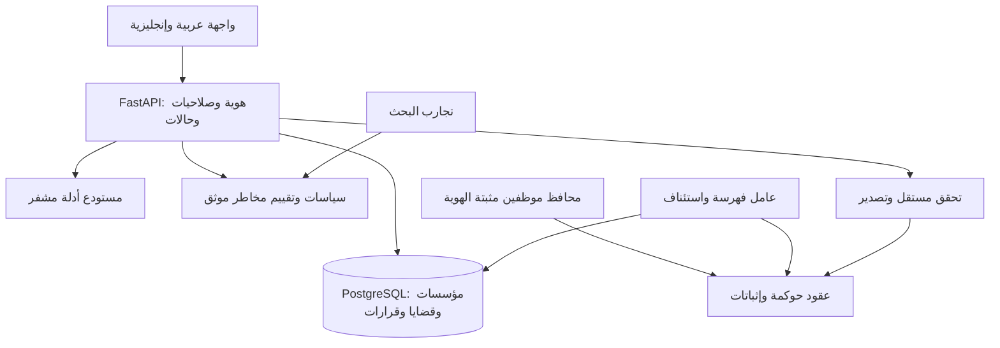

# تصميم تطوير المشروع للأهداف الأكاديمية والمؤسسية والتجارية

**التاريخ:** 2026-10-22 — **الحالة:** تصميم مقترح للتخطيط؛ لا يمثل تنفيذاً أو اعتماداً تنظيمياً.

## 1. الهدف والقرارات

بناء أساس موثوق واحد لمنصة تدقيق مالي وتحقيق رقمي، ينتج عنه ثلاثة مخرجات مترابطة:

| المسار | النتيجة المطلوبة | دليل النجاح |
|---|---|---|
| أكاديمي A | دراسة ومنصة تجارب قابلة لإعادة النتائج | بروتوكول تجارب، بيانات موثقة، مقارنة قواعد/تعلم آلي، نتائج وحدود معلنة |
| مؤسسي I | تجربة محدودة في جهة مالية | دورة قضية كاملة، صلاحيات صحيحة، أدلة قابلة للتحقق، استعادة وتشغيل موثقان |
| تجاري C | نسخة تجارية تجريبية متعددة المؤسسات | عزل بيانات وهوية وتخزين وحصص كل مؤسسة، تهيئة عميل، تصدير، مراقبة ودعم |

اختيار الأهداف الثلاثة جاء من طلب المستخدم. القرارات التقنية التالية توصيات تصميمية من مُعدّ الخطة، وليست متطلبات تنظيمية أو تفضيلات تقنية سبق أن حددها المستخدم.

- الحفاظ على React 18 وVite 5 وFastAPI وSolidity 0.8.20/Hardhat 2 في مرحلة التثبيت؛ الترقيات الكبيرة لها مهمة مستقلة لاحقاً.
- قاعدة PostgreSQL وسجل أحداث مفهرس لحالات العمل والبحث؛ مخزن كائنات مشفر للأدلة؛ EVM لإثباتات السلامة والحوكمة المختارة.
- تطبيق خلفي واحد منظم بوحدات، مع عامل فهرسة مستقل؛ لا تقسيم مبكر إلى خدمات كثيرة.
- إدخال `institution_id` وعزل المؤسسات منذ أول تخزين دائم، واختباره بمؤسستين اصطناعيتين، حتى لو بدأت التجربة المؤسسية بجهة واحدة.
- لكل مؤسسة مجموعة العقود الخمسة ومفاتيح حوكمتها الخاصة؛ registry الخادم يختار المجموعة من المؤسسة المصادق عليها. لا صلاحية حوكمة مشتركة بين العملاء.
- التطوير الأول ببيانات اصطناعية/مجهولة الهوية؛ بيانات المؤسسة الحقيقية تتطلب اتفاق استخدام واحتفاظ من مالكها قبل إدخالها.
- فصل بيئة `demo` عن `institutional`؛ الوضع المؤسسي لا يستخدم الحساب المفتوح رقم صفر أو نتائج محاكاة كبديل صامت.
- نطاق التجربة المؤسسية تدقيق وقرارات ومتابعة؛ التنفيذ الفعلي للتحويلات المالية خارج النطاق الأول.

## 2. خط الأساس الذي بُني عليه التخطيط

هذه نتائج المراجعة السابقة في المحادثة وليست اختبارات أُعيد تشغيلها عند كتابة الوثيقة:

- 105 اختبارات عقود و22 اختبار Python نجحت؛ بناء الواجهة نجح؛ فحص ESLint تعطل لغياب الإعداد.
- تجارب إضافية أثبتت انتحال تسجيل نشاط موظف، وإضافة أدلة من غير مخول، وإعادة استخدام موافقات، وتمرير تحقق غير كافٍ.
- طلبات الواجهة لفحص العقود والتقارير والأدلة لا تطابق مخطط Python؛ توجد ABI يدوية مخالفة للعقود.
- حدود 10 ETH في العرض تخالف 10,000 ETH في العقد؛ محرك ML غير محمل في الإعداد الحالي.
- كثير من الملفات الجديدة غير متتبعة في Git؛ لا يجوز حفظ أو حذف تغييرات المستخدم تلقائياً ضمن التخطيط.

## 3. المتطلبات المشتركة القابلة للتتبع

| المعرف | المتطلب |
|---|---|
| R01 | كل كتابة حساسة تتحقق من هوية وصلاحية المؤسسة والقضية والجهة المستدعية |
| R02 | كل موافقة ترتبط بفعل وهدف وبيانات وصلاحية، وتُستهلك مرة واحدة بشكل ذري |
| R03 | تعديل الحوكمة والأدوار والتأخير يخضع لحوكمة؛ لا امتياز دائم لمفتاح الناشر |
| R04 | التحقق يعيد حساب بصمة المحتوى ويقارن بسجل موثوق؛ النتيجة verified/invalid/unavailable |
| R05 | فشل الخدمة أو المحفظة أو الشبكة لا يولّد نجاحاً أو دور مسؤول أو تقريراً موثقاً |
| R06 | API وABI مولدان/متحققان آلياً؛ النماذج والأسماء موحدة وتُرفض الحقول غير المعروفة |
| R07 | مصدر واحد لسياسة مالية بإصدار ووحدة وعملة وتاريخ سريان؛ لا تحويل مالي ضمني |
| R08 | عمليات الحالة لها idempotency وإصدارات للتزامن، وتاريخ قرارات غير قابل للاستبدال |
| R09 | عزل المؤسسات مطبق في قاعدة البيانات والتخزين والبحث والمهام والتقارير |
| R10 | هوية مؤسسية عبر OIDC؛ ربط محفظة مثبت؛ صلاحيات الخادم والعقد مستقلة عن إظهار الأزرار |
| R11 | فهرسة قابلة للاستئناف، إزالة التكرار، إعادة تنظيم سلسلة، ومؤشر تقدم/تأخر |
| R12 | كل تقييم يحدد مصدر البيانات وإصدار السياسة والمحرك/النموذج وأسباب القرار |
| R13 | النتائج البحثية لها بروتوكول وفصل تدريب/اختبار وbaseline وقيود؛ لا أرقام مفترضة |
| R14 | لا إرسال للأدلة إلى نموذج سحابي افتراضياً؛ التنقيح والتفعيل لكل مؤسسة |
| R15 | التقرير يربط الأدلة والتحقق والقرارات، ولا يدعي اعتماداً قضائياً/رسمياً غير مثبت |
| R16 | نشر قابل للتكرار، مراقبة، استعادة واختبار حمل، وتوثيق تشغيل واستجابة للحوادث |
| R17 | النسخة التجارية تضيف التهيئة والحصص والتصدير والدعم وحدود الخدمة لكل مؤسسة |
| R18 | الحفاظ على تاريخ العقود القديمة؛ لا تعديل شبكة خارجية أو نقل أدلة دون خطة انتقال |

## 4. البنية المستهدفة ومصادر الحقيقة



| البيانات/القرار | المصدر الموثوق | ملاحظة |
|---|---|---|
| المستخدم والمؤسسة | OIDC + سجل عضوية الخادم | قيمة المؤسسة لا تُؤخذ من جسم الطلب كإذن |
| الدور الذي يجيز فعل EVM | RoleManager وربط المحفظة المثبت | دور واجهة العرض لا يمنح صلاحية عقد |
| حالة القضية والقرارات | PostgreSQL + تاريخ أحداث | دور REGULATOR للقراءة فقط |
| محتوى الدليل | الكائن المشفر غير القابل للاستبدال | SHA-256 للبايتات؛ إصدار تخزين ثابت |
| مرساة الدليل وموافقة العقد | الشبكة المسموحة + العقد المسجل | التحقق من chainId والعنوان وكود العقد |
| سياسة معاملات ETH الأصلية | نسخة سياسة العقد النشطة | تعرض الواجهة قيمة العقد الفعلية 10,000 ETH حتى تغيير محكوم |
| سياسة السجلات المصرفية IQD | PolicyVersion بالخادم | منفصلة عن سياسة ETH؛ لا وصف رقم تجريبي بأنه حد قانوني |
| قرار المخاطر | نتيجة محفوظة مرتبطة بمدخلات موثوقة | النموذج يقدم توصية؛ قرار المحقق له سجل مستقل |

جميع المستندات والهوية والأوصاف الحساسة تبقى خارج السلسلة. الإثباتات الجديدة تستخدم معرفات مبهمة وبصمات؛ العناوين والأوصاف القديمة ليست سرية لمجرد تخزينها في متغير private.

## 5. العقود والحوكمة V2

- العقود الحالية غير قابلة للترقية في مكانها. المسار المقترح نشر مجموعة V2 جديدة محلياً أولاً، وعناوين الإصدارات القديمة تبقى مسجلة للقراءة والتحقق.
- ترتيب النشر: MultiSigApproval(bootstrapAuthority) أولاً بلا RoleManager؛ ثم RoleManager(initialGovernance=multiSig)، ثم InsiderActivityLog وForensicTrail وAuditEngine بسلطة multiSig. `configureContracts(...)` و`bootstrapParticipants(...)` في multiSig متاحتان مرة فقط للbootstrapAuthority المؤقتة، وتفوضان ربط العقود وإدراج المشاركين فقط؛ كل التنفيذ العادي معطل قبل الإقفال.
- فحص وجود كود وتطابق المراجع واكتمال أربعة مشاركين مستقلين على الأقل ثم `finalizeBootstrap()` غير قابل للعكس، يصفر bootstrapAuthority ويمنع امتياز الناشر الدائم. إقفال bootstrap محلياً لا يساوي تفويضاً للنشر الخارجي.
- `MultiSigApproval` هو منسق الحوكمة والتنفيذ؛ لا إضافة منفذ عام آخر في المرحلة الأولى. يسمح فقط بأهداف ومحددات دوال معروفة من العقود الخمسة.
- `ProposalType` للأفعال الجديدة: OVERRIDE_WARNING, POLICY_CHANGE, EMERGENCY_UNPAUSE, ROLE_CHANGE, GOVERNANCE_CONFIG. لا تستخدم POLICY_CHANGE لرفع الإيقاف.
- `ProposalStatus`: PENDING, APPROVED, EXECUTED, REJECTED, EXPIRED, CANCELLED. حدث Approval لا يسمى Executed.
- `actionHash = keccak256(abi.encode(chainId, governanceAddress, proposalId, proposalType, target, keccak256(callData), notBefore, expiresAt))`.
- `createProposal(type,target,callData,reasonHash)` و`approveProposal(id)` و`executeProposal(id)`؛ المنسق يفحص الصلاحية والفعل والتوقيت ويضع EXECUTED ثم ينفذ؛ فشل الهدف يعيد كامل المعاملة.
- يلزم موافقان مستقلان غير مقدم الطلب؛ ثلاثة أشخاص على الأقل في كل دورة، وأربعة مشاركين مسجلين على الأقل لتحمل غياب واحد. لكل مشارك participant_id مبهم تشهد به المؤسسة ومحفظة حوكمة نشطة واحدة؛ التصويت يعد حسب participant_id. enrollment المؤسسي جهة ثقة معلنة ولا يثبت العقد وحده حقيقة هوية الإنسان.
- منفذ الاقتراح يمكن أن يكون مقدم الطلب إذا بقي مخولاً، لكن لا يصوت على طلبه. المصوّت والمنفذ لا يكونان طرفي المعاملة عند تجاوز التحذير؛ ربط proposer/executor/beneficiaries جزء من اختبارات SoD.
- تُعاد مراجعة أدوار المصوتين عند التنفيذ؛ كل تغيير دور/محفظة يرفع authorization_generation، وتخزن هوية المصوت وجيله مع صوته. السحب ثم إعادة منح الدور لا يحيي صوتاً قديماً؛ التدوير يلغي المحفظة السابقة ويجري بموافقة عادية. الموافقة المعتمدة تنتهي إذا انتهت المدة قبل التنفيذ.
- سياسة الحوكمة الجديدة: تأخير أدنى 24 ساعة لتغيير السياسة/الأدوار/إعدادات الحوكمة، صلاحية اقتراح 72 ساعة؛ رفع الإيقاف وتجاوز التحذير دون تأخير إضافي بعد اكتمال الموافقات. هذه قيم تجريبية مقترحة، وليست أرقاماً قانونية.
- حالة الإيقاف لها `pauseEpoch`؛ اقتراح رفع الإيقاف يرتبط بالحقبة الحالية، ولا يرفع إيقافاً لاحقاً.
- تسجيل النشاط عبر recorder معتمد فقط؛ تغيير recorder وساعات العمل يتم عبر الحوكمة. إضافة الدليل تتطلب دوراً معتمداً وصلاحية للقضية من مسار مؤسسي موثق.
- writer الأدلة المؤسسية هو خدمة إثبات مخصصة للمؤسسة؛ يتحقق الخادم من صلاحية المحقق للقضية قبل الإرسال. submitted_by في السلسلة هو عنوان الكاتب الفعلي، وهوية المحقق محفوظة في manifest موقع خارج السلسلة؛ لا تُنسب إليه معاملة لم يوقعها. AuditEngine كاتب مستقل للأحداث الآلية. هذه الخدمات جهات ثقة معلنة مع مفاتيح منفصلة وسجل طلبات، وليست مخولة بتوقيع موافقات الموظفين.
- `submitEvidence(incidentId,anchorRequestId,typeHash,descriptionHash,fileSha256)` يدعم deduplication في العقد: anchorRequestId عشوائي ثابت لكل عملية، يسجل payloadHash/evidenceId/entryHash؛ تكراره بنفس الكاتب والpayload يعيد السجل الموجود دون append أو event جديد، واستخدامه بمحتوى/كاتب مختلف يرفض. `getEvidenceByRequestId(bytes32)` يتيح reconciliation بعد crash. anchorRequestId مرجع توصيل مستقل لا يغير حقول بصمة EvidenceV2.

## 6. الأدلة والتحقق

واجهة النقل الجديدة `EvidenceV2`: schema_version, chain_id, contract_address, incident_id, evidence_id, submitted_by, timestamp, evidence_type_hash, description_hash, evidence_hash, previous_entry_hash, entry_hash. أعداد uint256 تنقل كسلاسل عشرية؛ hashes bytes32؛ addresses بطول 20 بايت.

البصمة V2 تُحسب بـ keccak256 على `abi.encode` للترتيب والأنواع التالية حرفياً:

```text
bytes32 DOMAIN = keccak256("CYBER_AUDIT_EVIDENCE_V2")
(bytes32,uint16,uint256,address,uint256,uint256,address,uint256,bytes32,bytes32,bytes32,bytes32)
(DOMAIN,2,chain_id,contract_address,incident_id,evidence_id,submitted_by,timestamp,
 evidence_type_hash,description_hash,evidence_hash,previous_entry_hash)
```

- `evidence_hash` هو SHA-256 لملف الدليل؛ type/description hashes من UTF-8 مع عدم تطبيع النص خفية. manifest التصدير يحتفظ بالقيم الأصلية وبقواعد الترميز.
- مجموعة fixtures واحدة تحتوي القيم المتوقعة من Solidity/Python/JavaScript؛ لا يُنتج الاختبار القيم المتوقعة بالدالة نفسها التي يختبرها.
- التحقق من الملف والهيكل والروابط والبصمات أولاً، ثم مطابقة الطول/آخر بصمة بالحادثة في العقد الموثوق. إثبات سلسلة قصيرة من رأس مصطنع لا يكفي.
- التحقق يقرأ السلسلة وcount/head من snapshot واحدة عند finalized block وفق مزود الشبكة؛ النتيجة تتضمن block_number وblock_hash. شبكة sandbox تستخدم تأكيدين للاختبار فقط. registry يحدد finality policy للشبكة الخارجية قبل استخدامها؛ تعذر canonical/finalized source يعيد unavailable. الإضافات اللاحقة لا تبطل snapshot قديمة صحيحة.
- التحقق يسترجع الملفات بإصداراتها الثابتة من مخزن معتمد، ويعيد SHA-256 للبايتات؛ manifest المحقق الموقع يربط institution/case/evidence_hash/chain_anchor/participant/timestamp. G1 يستخدم مستودع fixtures موثوقاً داخل الاختبار فقط؛ التحقق المؤسسي للملفات الحقيقية لا يفتح قبل T14.
- verified = كل المقارنات والمصدر نجحت؛ invalid = اختلاف مؤكد؛ unavailable = المصدر غير متاح/إصدار غير مدعوم؛ لا تُختزل unavailable إلى true أو false.
- قوائم فارغة أو حقول مفقودة/غير معروفة تُرفض 422. حقول صحيحة وبصمة مخالفة تعيد invalid.
- legacy_v1 له verifier منفصل يطابق abi.encodePacked القديم ويحذر من حدود ذلك الترميز؛ لا يعاد وسمه V2 ولا تعاد كتابة بياناته. العقود القديمة في registry مع cutoff block/hash؛ النتيجة تفصل integrity_status عن provenance_status=legacy_unrestricted_submission لأن الكتابة القديمة غير مقيدة. التطبيق يمنع كتاباته الجديدة عليها، لكنه لا يستطيع منع الآخرين من استدعاء عقد قديم غير قابل للتعديل.
- إيصال Merkle اختياري؛ لا يسمى مثبتاً حتى يطابق root مرساة موثوقة. لا اعتماد ذاتي لبصمة أنشأها المتصفح.

## 7. واجهات الخدمة والبيانات

- واجهات `/api/v1` الحالية تبقى في وضع demo للاختبارات القديمة. `/api/v2` هي واجهة التجربة؛ تستخدم نماذج صارمة `extra=forbid` وOpenAPI مولداً.
- `GET /api/v2/health/live` لحياة العملية، و`GET /api/v2/health/ready` لجاهزية DB/RPC/storage/indexer؛ تعطل التبعية يعيد 503 مع سبب آمن.
- `GET /api/v2/policies/active?asset=ETH` يعيد policy_id/version/currency/scale/thresholds/effective_at/source، حيث thresholds سلاسل صحيحة بالوحدة الصغرى.
- `POST /api/v2/risk/preview` لمحاكاة معلنة لا تصدر قراراً؛ `POST /api/v2/transactions/{id}/assess` يستمد المزايا من سجل موثوق ويعيد assessment_id/score/risk_level/factors/engine/policy_version/source.
- `POST /api/v2/evidence/verify` يستهلك `{case_id,incident_id,evidence_ids,schema_version,snapshot?:{block_number,block_hash}}`؛ يحل معرفات الأدلة إلى السلسلة والملفات المصرح بها، ويرجع status/provenance_status/checked_entries/reasons/anchor/source/block_number/block_hash. لا يقبل محتوى العميل كمرجع ثقة أو عنوان عقد حر؛ snapshot تفحص canonical/finality وصلاحيتها للقضية.
- `POST /api/v2/cases/{id}/evidence` يقبل multipart metadata/file وIdempotency-Key؛ AUDITOR المعيّن أو SUPER_ADMIN داخل المؤسسة فقط. يعيد202 مع evidence_id/anchor_request_id/status=PENDING_ANCHOR؛ عامل الإثبات المخصص للمؤسسة يحل outbox ويرسل ويطابق dedup record ثم ينتظر finality، وGET `/api/v2/evidence/{id}` يعرض الحالة. تعطل العامل بعد نجاح العقد وقبل حفظ ACK لا يكرر الدليل بفضل anchorRequestId الثابت. توقيع manifest هو شهادة الخدمة بهوية الطلب المتحققة، ولا يوصف كتوقيع محفظة المحقق إلا إذا وُجد توقيعه فعلاً.
- `POST /api/v2/cases/{id}/reports` يستهلك language وevidence_ids وassessment_ids؛ يستمد العنوان والمحقق والمؤسسة من الخادم، ويرجع report_id/version/dossier_hash/integrity_status/markdown/engine.
- `POST /api/v2/cases/{id}/transition` يستهلك expected_version/action/reason، مع Idempotency-Key؛ assign يغير مسؤول القضية دون قفز حالة. جدول الانتقالات أدناه هو عقد T16؛ كل فعل يحفظ صاحب القرار والمبرر والإصدار.

| الحالة الأصلية | الفعل | النتيجة | الدور/القيد |
|---|---|---|---|
| OPEN | start_review | IN_REVIEW | AUDITOR المعيّن |
| IN_REVIEW | request_approval | AWAITING_APPROVAL | AUDITOR المعيّن؛ يحفظ submitted_by |
| AWAITING_APPROVAL | approve_resolution | RESOLVED | AUDITOR آخر غير مقدم الحل/طرف المعاملة |
| AWAITING_APPROVAL | reject_resolution | IN_REVIEW | AUDITOR آخر مع سبب |
| IN_REVIEW أو AWAITING_APPROVAL | escalate | ESCALATED | AUDITOR أو SUPER_ADMIN |
| ESCALATED | return_to_review | IN_REVIEW | SUPER_ADMIN مع سبب وتعيين |
| RESOLVED | close | CLOSED | AUDITOR المراجع أو SUPER_ADMIN |
| CLOSED | reopen | IN_REVIEW | SUPER_ADMIN مع سبب وتعيين؛ لا محو قرار سابق |

REGULATOR لا يكتب؛ إنشاء المعاملة بواسطة OPERATOR لا يمنحه حق اعتمادها. اعتماد تجاوز تحذير في العقد لا يحل القضية آلياً؛ ربطه بقرار القضية صريح ويحفظ مرجعه.
- أخطاء موحدة: code/message/request_id/details؛ لا stack traces أو أسرار أو سجل أدلة في الخطأ.
- عدد العناصر في الصفحة <=100؛ batch preview <=100؛ مصدر عقد <=200KB؛ حدود ملفات الأدلة المقترحة 25MB للملف، مع رفض مبكر وتدفق upload لا يحمل الملف كاملاً في الذاكرة.
- المرحلة المؤسسية تدعم institution_id واحداً حقيقياً وآخر اختبارياً، مع RLS وسياق مؤسسة محدد داخل transaction لكل استعلام؛ حساب التطبيق ليس مالك الجداول ولا يملك BYPASSRLS.

## 8. الهوية والأموال والزمن

- OIDC Authorization Code + PKCE مع issuer/audience/expiry والتحقق من التوقيع؛ مزود الهوية قابل للإعداد. لا بناء كلمات مرور محلية جديدة.
- ربط محفظة بتحدي أحادي الاستخدام مدته 5 دقائق، مقيّد domain/chainId/sub/institution_id؛ إثبات ملكية المفتاح لا يمنح دوراً تلقائياً.
- قيم المال الصحيحة تنقل كنص، Python Decimal/int وJavaScript BigInt؛ لا float في الحساب المالي. ETH scale=18، بيانات IQD scale=3 في مخطط التجربة؛ CSV يعلن scale صراحة ويُرفض المخالف.
- حساب IQD مستقل؛ لا تحويل ETH/IQD ثابت في قرار امتثال. عرض تحويل اختياري يحمل مصدره وتوقيته، ويخفى إذا لم يوجد مصدر صالح.
- سياسة IQD التجريبية fixture واحدة بإصدار DEMO-IQD-1؛ القيم أعداد اختبار لا توصف بمتطلبات CBI. لا تنشط سياسة مؤسسية إلا بمرجع وموافقات مالك الامتثال.
- تخزين الوقت UTC؛ تحديد ساعات العمل بسياسة المؤسسة `Asia/Baghdad` مع تقويم أيام العمل والعطل. نافذة التجزئة rolling 10 دقائق و24 ساعة؛ عداد العقد اليومي UTC يُعرض باسمه الحقيقي ولا يسمى rolling 24h.

## 9. البحث والتعلم الآلي

- بروتوكول مسبق: baseline قواعد، Isolation Forest، ومزيجهما؛ نفس المدخلات ونفس تقسيم البيانات لكل مقارنة.
- فصل زمني وفصل هوية العملاء بين التدريب والاختبار، بذور ثابتة، بصمات dataset/code/model، وسجل توليد البيانات الاصطناعية.
- قياس precision/recall/F1 وPR-AUC والإنذارات لكل 1000 معاملة وزمن p95؛ فواصل عدم اليقين عند كفاية العينة، وإعلان عدم الكفاية خلاف ذلك.
- لا هدف دقة تسويقي مفترض؛ النموذج يفعّل افتراضياً فقط إذا حقق recall لا يقل عن baseline وfalse positives أقل على الاختبار المحجوز، وإلا تبقى القواعد الافتراضية ويُوثق فشل الفرضية.
- لا تحوّل العناوين أو أسماء الموظفين أو نتيجة قاعدة إلى ground truth. البيانات الاصطناعية تثبت سلوك النظام التجريبي، ولا تثبت تعميمه المصرفي.
- regex scanner يُسمى Pattern Scanner؛ فحص AST فعلي منفصل بأداة تحليل موثقة، ولا نتيجة اسمها SECURE اعتماداً على غياب أنماط فقط.
- خدمة LLM اختيارية قابلة لتبديل المزود/النموذج؛ لا تتحكم بصحة الدليل أو تنفيذ الحوكمة. فشلها ظاهر ولا يغير حقائق التقرير.

## 10. الجودة والتشغيل ومؤشرات القبول المقترحة

- قاعدة الاختبارات الحالية تحفظ إلا عندما تغيّر V2 سلوكاً مقصوداً، ويُذكر التغيير في اختبار ووثيقة انتقال؛ لا تعديل assertion لمجرد تمرير اختبار فاشل.
- CI: عقود + Python + واجهة + اختبارات عزل/تكامل + فحص تغيّر المخططات + فحص اعتماديات وأسرار؛ لا نتائج نجاح مصطنعة.
- لا ثغرات Critical/High غير معالجة عند التجربة؛ الاستثناء يحتاج سجل مخاطرة ومالكاً وسبباً وحدوداً، ولا يغطي انتحال السجل أو تجاوز الصلاحيات أو تحققاً كاذباً.
- بيئة حمل مرجعية 4 vCPU/8GB RAM محلياً، مولد حمل خارجي، 100 مستخدم افتراضي و10 طلبات/ث لمدة 30 دقيقة، 100 ألف معاملة و10 آلاف قضية.
- أهداف أولية: p95 للقوائم <=500ms؛ تقييم القواعد <=300ms؛ أخطاء غير متوقعة <1%؛ فهرسة <=2 دورات تأكيد +30 ثانية. LLM ووقت تأكيد البلوكشين خارج هذه الأزمنة.
- هدف الاستعادة: RPO <=15 دقيقة وRTO <=ساعتين، ويثبت بتجربة فعلية تشمل DB والكائنات ومراجع العقود، لا بمجرد وجود ملف backup.
- المستهدفان السابقان اتفاق هندسي مقترح يعاد ضبطه بعد أول قياس؛ لا يوصفان بأنهما أداء حالي أو SLA متعهد به.
- النسخة التجارية: تقيس التوافر 30 يوماً قبل تحديد SLA؛ سجل استخدام وحصص لكل مؤسسة؛ فواتير حية وتحصيل المدفوعات خارج النطاق الأول.

## 11. المخرجات المؤجلة والقرارات التي تسبق استخدامها

لا تنفيذ دفع حقيقي، لا نشر تلقائي على شبكة عامة، لا نشر ورقة أو بيانات، لا مراسلة مؤسسات، ولا ادعاء اعتماد تنظيمي ضمن هذه الخطة. النموذج التجاري المستهدف أولاً نشر مُدار مع عزل مؤسسات؛ نشر داخل شبكة العميل مسار تغليف لاحق.

قبل إدخال بيانات حقيقية: مالك المؤسسة يحدد الاحتفاظ وموقع البيانات والمخولين. قبل شبكة خارجية: اختيار الشبكة وموقعي الحوكمة وحفظ المفاتيح وإجراءات الاسترداد. قبل خدمة تجارية: مالك المنتج يحدد العملاء الأوائل والتسعير والدعم والعقود؛ التطوير التقني يستطيع التقدم ببيانات وخدمات اختبارية حتى ذلك الوقت.

## 12. تتبع التسليم

خارطة التنفيذ: [الخطة الرئيسية](../plans/2026-10-22-three-track-roadmap.md).

تنفيذ الخطط الفرعية بالتتابع على المسار الحرج، مع تداخل مهام البحث والتوثيق التي لا تغيّر عقود التكامل. التخطيط لا يصرح ببدء تعديل كود المنتج؛ طلب تنفيذ لاحق يحدد نقطة البداية.
